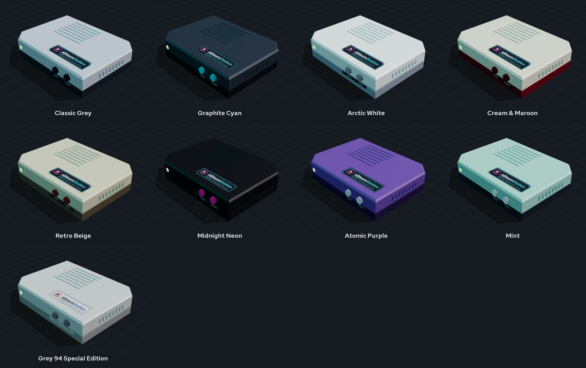
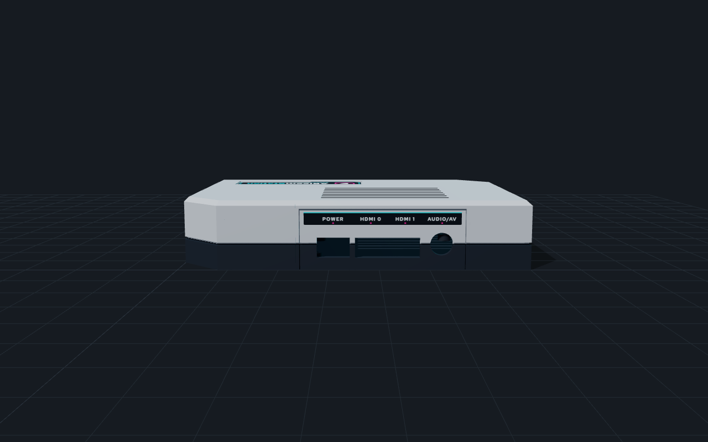
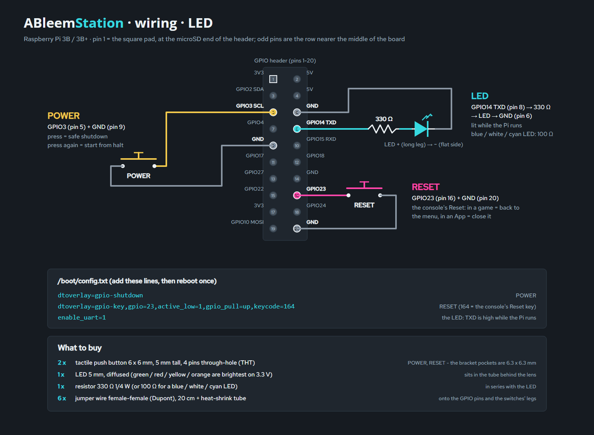
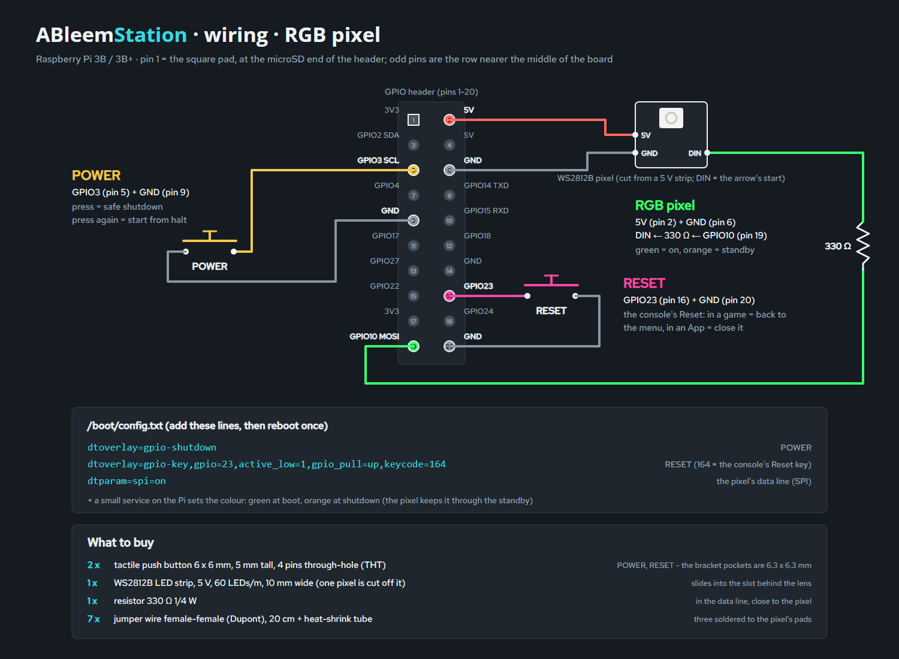

# ABleemStation - Open Source Retro Gaming Console

A 3D-printable, 90s-style console case for the Raspberry Pi, with working **POWER** and **RESET** buttons, a front
**LED** (a plain 5 mm LED or an RGB pixel that glows green while the Pi runs and orange in standby), hidden cooling
vents, stickers and a 3D viewer. It is made for small retro-gaming consoles (AutoBleem and any other
frontend: the buttons are plain Linux key and shutdown events), but nothing in it depends on the software.



## Status: draft

This is a **draft**. The case has been through several test prints, but several newer parts have **not** been fully
test-printed yet: the one-piece universal bottoms (base with welded panels), the front-USB snap-in cradles, and
the latest base / shell tweaks. Expect a tolerance round when you print them, and
please report what you find. Also:

- The **RGB colour service** (green while the Pi runs, orange at shutdown and in standby) is not part of this repository.
  It is a small service on the Pi that writes the colour to the WS2812B pixel over SPI (`dtparam=spi=on`, data on
  GPIO10), planned as part of the AutoBleem software. Until it ships, the pixel keeps whatever colour you set from
  your own script, and the plain 5 mm LED version needs no software at all.
- The viewers need an internet connection (three.js is loaded from a CDN).

## The two cases

| | Pi 3 case | Universal case |
|---|---|---|
| Boards | Raspberry Pi 3B / 3B+ | Raspberry Pi 2B, 3B, 3B+, 4B, 5 |
| Size | 140 x 105 x 27.6 mm | 140 x 105 x 27.6 mm |
| Port walls | part of the shell | separate panels per board, locked in by the base |
| Front USB | no | optional: two USB-A sockets in the front panel |
| Cooling | hidden roof + side vents | the same, or a longer vent field over the Pi 5 Active Cooler |
| Files | `files/` | `files/universal/` |

Both share the base, the buttons, the lens, the stickers and the wiring. Start with the Pi 3 case if you have a Pi 3;
use the universal case for every other board.

## Quick start

1. Open `files/ableemstation-viewer.html` (Pi 3) or `files/universal/ableemstation-universal-viewer.html` in a
   browser, pick the board, the light (5 mm LED or RGB pixel) and a colourway, and press **Download ZIP**: you get
   exactly the print files, Orca profiles, stickers, wiring diagram and a `BUILD.txt` for that option.
2. Print the parts ([Printing](#printing-asa-or-pla-no-supports)), buy the [parts](#parts), wire the
   [buttons and the light](#wiring-bcm-numbers-physical-pins-in-brackets).
3. Follow the [assembly steps](#assembly), stick on the [stickers](#stickers).
4. Add the `config.txt` lines from the wiring section to the Pi.

## The 3D viewer

Both viewers are single HTML files (three.js is loaded from a CDN, so they need internet). Controls:

- drag = orbit, wheel = zoom, right-drag = move;
- **Preview** views: 3/4, Front, Back, Right, Top, Side, Bottom (the bottom view is lit from below);
- **Explode** pulls the parts apart; **Show Pi** shows the board; **X-ray** makes the shell transparent;
  **Hide shell** / **Hide base** remove a group;
- **RGB LED** switches to the RGB-pixel shell; **LED: standby** shows the standby state (the plain LED goes dark, the
  RGB pixel turns orange);
- **Theme** buttons recolour the model and swap the sticker set;
- the universal viewer also has the **Raspberry Pi model** choice, the panel options (**Front USB**, **Rear USB
  cover**) and **Active roof** (the vent field for the Pi 5 Active Cooler);
- **Download ZIP** builds the option on screen into a ZIP in the browser (nothing is uploaded anywhere).

URL options (both viewers): `&led=rgb`, `&cw=<colourway>` (`classic`, `graphite`, `arctic`, `cream`, `beige`,
`midnight`, `purple`, `mint`, `grey94`), `&shell=0`, `&base=0`.

## Colourways

Each colourway is a top colour (above the waist groove), a band colour (below it - this is the filament change), a base
and button colours, chosen from ASA colours that exist off the shelf. The LED is always cyan in the viewer.

| Name | Top | Band | Base | Buttons |
|---|---|---|---|---|
| Classic Grey | `#c4c8cd` | `#2e3742` | `#3a414a` | `#2e3742` |
| Graphite Cyan | `#3a434e` | `#1b2026` | `#1b2026` | `#36d9e0` |
| Arctic White | `#f1f1ec` | `#9aa3ad` | `#6d757e` | `#9aa3ad` |
| Cream & Maroon | `#e8dfcb` | `#7d1f2b` | `#4a3a32` | `#7d1f2b` |
| Retro Beige | `#d6cdb2` | `#6b5e4d` | `#4f463b` | `#8a3b2e` |
| Midnight Neon | `#1f2125` | `#1f2125` | `#121316` | `#ff46aa` |
| Atomic Purple | `#7a5ca8` | `#3b2a57` | `#2a1e3e` | `#e6e0f0` |
| Mint | `#a9d6c6` | `#2e3742` | `#2e3742` | `#f1f1ec` |
| Grey 94 Special Edition | `#cfcdc8` | `#9c9a96` | `#6e6d6a` | `#85848a` |

In the universal case the base prints with the panels, so it takes the band colour.

## Files (`files/`)

| File | What |
|---|---|
| `ableemstation-{shell,shell-rgb,base,buttons,lens}.step` | the parts for CAD (Fusion, FreeCAD, SolidWorks); `ableemstation-assembly.step` = everything in place |
| `ableemstation-{shell,shell-rgb,base,buttons,lens}.stl` | the parts for the slicer (`shell` = plain LED, `shell-rgb` = RGB pixel) |
| `ableemstation-{shell,shell-rgb,base,buttons,lens}.3mf` | the same, already turned the way they print (shell roof-down, the button tree flat with the shafts up, the lens flange-down) |
| `ableemstation-all-parts.3mf`, `-all-parts-rgb.3mf` | everything to print in one file, per LED version: shell, base, the button tree, the lens |
| `ableemstation-viewer.html` | the 3D viewer with the "Download ZIP" of the option on screen (three.js from a CDN, so it needs internet) |
| `renders/` | 3/4, front, back, side, exploded with the Pi, X-ray; `colors/` + `colorways.png` = the colour options |
| `stickers/ableemstation-stickers-A4.pdf` | the sticker sheet, 1:1, cut lines: one ab2.0.0 set and one special-edition set (the same sheet in `stickers/special/`); `stickers/*.svg` / `*.png` = each sticker |
| `stickers/cricut-144dpi/` | one transparent PNG per sticker at 144 dpi, for a Cricut's Print Then Cut; `ableemstation-all-stickers.png` = every sticker of both sets on one sheet (170 x 152 mm) |
| `wiring.svg`, `wiring.png` | the wiring diagram + what to buy, plain LED (`src/make_wiring.py`) |
| `wiring-rgb.svg`, `wiring-rgb.png` | the same with a WS2812B RGB pixel instead of the LED |
| `universal/` | the universal case: shells, panels, viewer, renders ([Universal case](#universal-case-pi-2--3--4--5)) |
| `orca/` | Orca Slicer process profiles: "ABleemStation - ASA" (quality), "ABleemStation - ASA Base" (the base, 0.20 mm) and "ABleemStation - ASA Prototype" (fast fit test) |

Layout: back = power, HDMI, audio (the TV cables). Seen from the front, the USB + Ethernet are on the left side,
the LED is front-left, and RESET / POWER are front-right (RESET on the left, as the sticker under them says). The microSD can be reached through a finger-sized window (35 x 20 mm) in the floor.

## Building the files (`src/`)

Every size is a variable at the top of `make_case.py`, and every file in `files/` is generated - change the
script, never a file. Needs Python 3, `pip install build123d`, and Chrome for the renders, the PDF and the
sticker PNGs (`CHROME=<path>` if it is not found).

```
cd src
python make_all.py           # everything below except the wiring and Orca, in this order - use it after any change
python make_case.py          # parts: STEP, STL, 3MF; the fit check (the Pi must overlap the case by 0 mm3)
python make_universal.py     # the universal case: shells + panels to files/universal/, fit checks per board
python make_stickers.py      # stickers: SVG, PNG, the A4 PDF, the Cricut PNGs
python make_viewer.py        # the viewer + the renders (after the two above)
python make_viewer.py universal   # the universal case's viewer + renders
python make_wiring.py        # the wiring diagram
python make_orca_profile.py  # the Orca profiles to files/orca/ (--install also copies them into Orca's user folder)
```

`src/fonts/` holds Open Sans and Red Hat Text (SIL Open Font License, the licences are next to the fonts).

### Checks (`src/checks/`)

Small scripts used while developing; run them from the repo root. Each prints its numbers and (where it makes a page)
writes it to `build/checks/` (git-ignored):

| Script | What it checks |
|---|---|
| `make_bottom_check.py [model] [front]` | the one-piece bottom: base + the three panels in their rebates, a 3D page with a section slider, the panel / base overlap (the weld) |
| `make_cap_tree_check.py` | the button tree against the shell (fit numbers + page) |
| `make_cap_retainer_check.py` | the comparison of two ways to keep the button caps in (rails vs melted pins) |
| `make_led_holder_check.py` | the LED corner: tube vs RGB block, how far each holder reaches into the shell |
| `make_switch_check.py` | the switch bracket with two 6x6x5 tact switches: where a switch hits the bracket |
| `make_fit_coupon.py` | a small test print of the universal shell's front opening + the blank panel, to try the panel clearance without printing a shell |
| `make_switch_coupon.py` | a 44x9x21 mm test print of the switch pockets (6.8 mm) and leg holes (2.0 mm), to try the tactile switches before printing the base |

## Printing (ASA or PLA, no supports)

- **shell**: upside down (roof on the bed). Two colours: a filament change at the layer that starts the dark band -
  **16.68 mm = layer 104** with 0.16 mm layers, **16.80 mm = layer 70** with 0.24 mm layers (the layer numbers as
  Orca's layer slider counts them, from 1; `make_case.py` prints both). Everything above it is the lower band.
- **base**: flat, standoffs up - with "ABleemStation - ASA Base" (0.20 mm: nobody sees it). **buttons**: one part, the
  button tree - both caps on flexible strips - flat with the shafts up. Push its two ears on the two pins inside the
  shell (behind the buttons), then melt the pin ends flat with a soldering iron: the caps stay in the shell for good
  and still move, each on its own strip.
- **lens**: clear PETG, standing on the flange, 100 % infill and slow, so it stays as clear as it can.
- ASA: a closed, warm chamber; let the parts cool on the bed.

The Orca profiles target a Voron Trident 300 (0.4 nozzle, Klipper) set up on Orca's "MyKlipper 0.4 nozzle" printer;
use them with a calibrated ASA filament profile (temperatures, flow ratio and shrink come from the filament).
- **ABleemStation - ASA**: 0.16 mm layers, 5 walls (the 2.4 mm walls are solid perimeters), Arachne, outer wall /
  top 60 mm/s at 3000 mm/s², seam at the back, precise outer wall, hole compensation 0.1 mm, elephant foot 0.15 mm,
  mouse-ear brim, gyroid 25 %.
- **ABleemStation - ASA Base**: the final base (or `uni-base`) - hidden under the case, so 0.20 mm layers, 4 walls,
  20 % gyroid, walls at 120 / 180 mm/s; the fit settings (hole and elephant-foot compensation) stay, since the base
  sits inside the shell and carries the standoffs and the countersunk screws.
- **ABleemStation - ASA Prototype**: the same fit settings with 0.24 mm layers, 3 walls, 12 % grid and walls at
  150 / 220 mm/s - a fast print that still answers "does it fit".

In Orca, the colour change goes on the layer slider in the preview ("+" -> Change filament for a second spool in a
multi-material unit, or Add pause for a manual swap; `M600` only if the printer has that macro).

## Hidden vents and the LED

- **Roof**: the slots run straight through the 3.2 mm roof at 45 degrees, down towards the front, so each slot's
  inner end lies 3.2 mm in front of its outer end - more than the slot is wide (2.4 mm). Air passes, the eye does
  not: looking down, or from in front, you see the slot's sloping wall. Printed roof-down, a 45 degree wall needs no
  bridge (an earlier labyrinth with a bridged channel printed shut).
- **Side** (opposite the USB): slots through the wall with a baffle 1.8 mm behind them, closed at both ends and
  open below, so the air turns down under it and the inside stays out of sight.
- **LED**: the clear lens is pushed into the front hole from inside (its flange sits in a counterbore), and the
  LED stays hidden behind it. The shell body is the same for both lights; the LED holder is a part of its own that
  reaches 0.6 mm into the front wall and the roof, so in the 3MF (one object, two parts) the slicer welds it into
  the shell:
  - `shell`: a plain 5 mm LED in the holder tube, its tip 0.3 mm behind the lens;
  - `shell-rgb`: one **WS2812B** pixel cut from an LED strip (10 mm wide), slid into the slot behind the lens from
    below, the LED facing the lens, the three wires out at the bottom. It keeps its last colour while it has 5 V -
    so a small service on the Pi sets green at boot and orange at shutdown, and the orange stays on through the
    standby, as on the PlayStation Classic.

## Universal case (Pi 2 / 3 / 4 / 5)

The boards share the 85 x 56 mm outline, the mounting holes and the GPIO header, so the base, the buttons, the lens
and most of the shell are the Pi 3 case's. What differs are the ports on two edges - and the front can take USB:

| Opening | Panels (`files/universal/ableemstation-panel-*`) |
|---|---|
| back (power, HDMI, audio) | `back-pi23` (micro-USB, HDMI, audio) · `back-pi4` (USB-C, 2 x micro-HDMI, audio) · `back-pi5` (USB-C, 2 x micro-HDMI) · `back-blank` |
| side (USB, Ethernet) | `right-pi23` · `right-pi4` (Ethernet and USB swapped) · `right-pi5` · each also `-front` (one USB block closed, see below) · `right-blank` (to drill yourself) |
| front (between the buttons and the LED) | `front-blank` · `front-usb` (two USB-A sockets) |

- **Assembly - everything on the base**: `uni-base` is the Pi 3 case's base plus a rebate along each opening and
  the front USB pedestal. Screw the Pi down, fit the switches and the USB sockets, and stand the panels in the
  rebates (a tab on each panel's inside sits in it). Then slide the shell down over it all: each panel's tongue (its
  inner half) runs up the grooves in the opening's sides and ends in a groove in the roof. Four screws from below,
  done. Swapping a board = lifting the shell and swapping two panels (with the one-piece bottom below: a new bottom).
- **Shells**: `uni-shell` (the hidden roof vents of the Pi 3 case) and `uni-shell-active` (a longer, 8-slot field over
  the Raspberry Pi 5 **Active Cooler**, 63.5 x 42.5 x 13.7 mm - it fits under the roof with 3 mm to spare), each also
  `-rgb` for the RGB pixel. A Pi 5 without the cooler throttles under a long load; the active shell is for it.
- **Front USB**: two "USB-A female to DIP" breakout boards (the common 17 x 17 mm board: a USB-A 2.0 socket, two 3 mm holes 12 mm apart, four 2.54 mm pins) lie flat on pedestals of the base, each held by two ~1.85 mm sheet-metal screws straight into the plastic (1.7 mm holes through the pedestal and the plate; the socket sits 1.3 mm above the board); a step in front of each board carries the socket's overhang, and pockets under the board take the solder tails (the pin row's pocket is open to the back for the wires). Their fronts sit
  just behind `front-usb`, which has only the two plug windows - each in a 1.4 mm recess, so a
  plug still goes in its full depth. With `front-blank` the pedestal is hidden, so there is one base for both.
  The sockets' cables are soldered to the four pins of one rear USB block, under the board - the block furthest from
  the Ethernet (Pi 2/3/5: the one by the GPIO header; Pi 4: the one at the board's edge). Nothing is desoldered;
  the `right-…-front` panel closes that block from outside. Front and back of that block are wired together - use
  one of them at a time. On a Pi 4 / 5 the front ports run at USB 2.0.
- **Printing - four prints**: the shell, the **bottom**, the button tree and the lens. The bottom
  (`uni-bottom-<board>-<front>.3mf`, e.g. `uni-bottom-pi4-usb`) is the base with that option's three panels standing
  in their rebates - one object of four parts in Orca. Print it as it is: each panel's tab sits on its seat, so the
  panels weld to the base and the bottom comes off the bed in one piece (nothing to assemble).
  With the front USB there is also `uni-bottom-<board>-usb-open`: the rear USB block that feeds the front stays
  open (use the front or the rear, not both at once). The panels' filament change below applies to it: the base starts in the band colour and its few tall bits (the
  standoffs, the USB cradles) end in the top colour, inside the case. The viewer's download picks the bottom of the
  option on screen. The separate panels below stay for a board swap or a reprint of one wall.
- **Printing the panels on their own**: panels print **standing** on their bottom edge, so a filament change gives them the shell's two
  colours on the same line: **10.92 mm = layer 68** with 0.16 mm layers, **10.80 mm = layer 45** with 0.24 mm (`make_universal.py` prints
  both). Dark first, then the top colour. The panels are 2.4 mm thick where they stand, so use a brim (the Orca profiles' mouse ears or a 5 mm brim).
  `ableemstation-panels-all.3mf` has every panel on one plate.
  Shells, `uni-base`, buttons and lens as for the Pi 3 case (the buttons and lens files are the same).
- **POWER on a Pi 5**: GPIO3 shuts it down (`dtoverlay=gpio-shutdown`) but cannot wake it from halt. Wire the POWER
  button to the board's **J2** pads (the power-button header) instead: it then works like the board's own button.
  RESET, the LED and the RGB pixel are wired the same on every board.
- Port positions come from Raspberry Pi Ltd's mechanical drawings (3B+, 4B, 5); `make_universal.py` checks every
  board against every shell and its panels (0 mm3 overlap) and fails if one touches.



## Parts

| Qty | Part |
|---|---|
| 4 | M3 heat-set insert, Voron's standard M3 x 5 x 4 (the bosses have a 4.7 mm hole, 6 mm deep), pressed into the shell's bosses |
| 4 | M3 x 8 countersunk screw (base -> inserts) |
| 4 | M2.5 x 5 screw (Pi -> standoffs, cuts its own thread in the 2.3 mm hole; a 0.6 mm lead-in chamfer on top) |
| 2 | 6 x 6 mm tactile switch, 5 mm tall, 4 pins through-hole, on its back in the bracket's pocket, each leg through its own hole - solder the wires to the legs behind the bracket |
| 1 | the front light, either: a 5 mm diffused LED + 330 Ω 1/4 W resistor (100 Ω for blue / white / cyan), or one WS2812B pixel cut from a 5 V, 10 mm strip + 330 Ω resistor |
| 6-7 | jumper wire female-female (Dupont), 20 cm, + heat-shrink tube |
| 4 | rubber feet Ø 12 mm |
| (2) | universal case, front USB: "USB-A female to DIP" breakout board (17 x 17 mm) + 2 sheet-metal screws ~1.85 x 6 mm + 4-wire cable (about 15 cm) per socket |

## Assembly

Pi 3 case:

1. **Inserts.** Press four M3 heat-set inserts (M3 x 5 x 4) into the shell's bosses with a soldering iron, from
   below. The hole is 4.7 mm, 6 mm deep.
2. **Button tree.** Push the button tree's two ears onto the two pins inside the shell, behind the button holes,
   and melt the pin ends flat with a soldering iron. The caps stay in the shell and move, each on its own strip.
3. **Lens.** Push the clear lens into the front hole from inside (its flange sits in the counterbore).
4. **LED.** Plain version: push the 5 mm LED into the holder tube behind the lens, with its resistor on one leg.
   RGB version: slide a WS2812B pixel (cut from a 10 mm, 5 V strip) into the slot behind the lens from below, LED
   facing the lens, wires out at the bottom.
5. **Switches.** Lay the two 6 x 6 mm tact switches on their backs in the base's bracket, each leg through its own
   hole, and solder wires to the legs behind the bracket.
6. **Pi.** Screw the Pi onto the base's standoffs with four M2.5 x 5 screws (they cut their own thread).
7. **Wiring.** Connect the Dupont wires as in the [wiring](#wiring-bcm-numbers-physical-pins-in-brackets) section;
   use heat-shrink on the soldered joints.
8. **Close.** Lower the shell over the base, turn the case over and fasten the four M3 x 8 countersunk screws into the
   inserts. Stick on the rubber feet and the stickers.

Universal case: the same, with these differences. Assemble everything on the base: screw down the Pi, fit the
switches and (if used) the two front USB sockets, stand the panels in the base's rebates, and slide the shell down
over it all; each panel's tongue runs up the grooves in the shell's opening. With the one-piece bottom
(`uni-bottom-...`) the panels are already part of the base. See [Universal case](#universal-case-pi-2--3--4--5).

## Wiring (BCM numbers, physical pins in brackets)

Two versions of the front light, the same buttons:





- **POWER**: GPIO3 (pin 5) to GND (pin 9); `dtoverlay=gpio-shutdown` in `config.txt` - press to shut down, press
  again to wake the Pi from halt.
- **RESET**: GPIO23 (pin 16) to GND (pin 20);
  `dtoverlay=gpio-key,gpio=23,active_low=1,gpio_pull=up,keycode=164` in `config.txt`. Keycode 164 is the key the
  PlayStation Classic's Reset button sends, so AutoBleem treats it the same way: in a game it goes back to the menu,
  in an App it closes the App. It is a software reset, not a power cycle.
- **LED** (plain version): GPIO14 / TXD (pin 8) -> 330 Ω -> LED -> GND (pin 6); with `enable_uart=1` it is lit while
  the Pi runs. Green / red / yellow / orange LEDs are the brightest on 3.3 V; a blue / white / cyan one wants 100 Ω.
- **RGB pixel** (RGB version): 5V (pin 2), GND (pin 6), DIN <- 330 Ω <- GPIO10 / SPI MOSI (pin 19), with
  `dtparam=spi=on`. A small service on the Pi sets the colour - green while it runs, orange at shutdown; the pixel
  keeps its last colour as long as it has 5 V, so the standby stays orange like on the console.

## Stickers

- Inkjet / laser on vinyl: print `stickers/ableemstation-stickers-A4.pdf` at 100 % (no "fit to page"); the top plate
  must measure 61 mm. The roof and the front have 0.4 mm recesses the stickers sit in.
- Cricut (Print Then Cut): upload the PNGs from `stickers/cricut-144dpi/`. If Design Space shows a different size,
  set it by hand: top 61 x 17 mm, front 43 x 4.6 mm, side 80 x 8 mm, bottom 54 x 34 mm, back 62 x 5 mm.
  `ableemstation-all-stickers.png` is every sticker of both sets on one transparent sheet: upload it once, set its
  width to 170 mm (it fits Print Then Cut's 6.75 x 9.25 in), and Design Space cuts each sticker on its own.
- Special edition: `stickers/special/` is the same set in "Grey 94" colours (light grey, dark text, four colour
  accents) for the Grey 94 Special Edition colourway - colours only, no third-party marks.
- Bottom plate: one per board - `sticker-bottom` (Pi 3), `sticker-bottom-pi4`, `sticker-bottom-pi5` - with a light box
  for the serial number: write it in with a permanent marker before sticking it on.
- Back panel (universal case): one per board - `sticker-back-pi23` (POWER, HDMI, AUDIO/AV), `sticker-back-pi4`
  (POWER, HDMI 0, HDMI 1, AUDIO/AV), `sticker-back-pi5` (POWER, HDMI 0, HDMI 1) - on the panel above its port windows,
  each label over its port (a small mark points at it). AUDIO/AV: the Pi 3 / 4 jack carries audio and composite video.

## Layout of the repository

```
README.md           this file
CONTRIBUTING.md     how the files are generated and the design rules (for contributors)
files/              every generated output (STEP, STL, 3MF, viewers, renders, stickers, wiring, Orca profiles)
  universal/        the universal case's parts, panels, viewer, renders
  viewer/           meshes + parameters the viewer reads (generated)
LICENSE            CC BY-SA 4.0 (models, wiring, stickers, renders, documents)
LICENSE-CODE       MIT (the scripts in src/)
src/                the generators (Python, build123d); fonts/ with their licences
src/checks/         development checks and a fit coupon (see Building the files)
```

Every file in `files/` is generated by `src/`. Change the script, not the file ([CONTRIBUTING.md](CONTRIBUTING.md)).

## Licence

- **Models, wiring diagrams, stickers, renders and documentation** (everything in `files/` and
  the documents): [Creative Commons Attribution-ShareAlike 4.0 International](LICENSE) (`CC-BY-SA-4.0`).
- **Scripts** (everything in `src/`, including `src/checks/`): [MIT](LICENSE-CODE) (`MIT`).
- **Fonts** in `src/fonts/` (Open Sans, Red Hat Text): SIL Open Font License; their licence texts are next to them.
  The fonts are also embedded in the sticker and wiring artwork, which is allowed by the OFL.
- The viewers load three.js (MIT) from a CDN at run time; it is not part of this repository.

Raspberry Pi is a trademark of Raspberry Pi Ltd; PlayStation is a trademark of Sony Interactive Entertainment. This
project is not affiliated with or endorsed by either company; the names are used only to say what the case fits and
which key code the RESET button sends.
